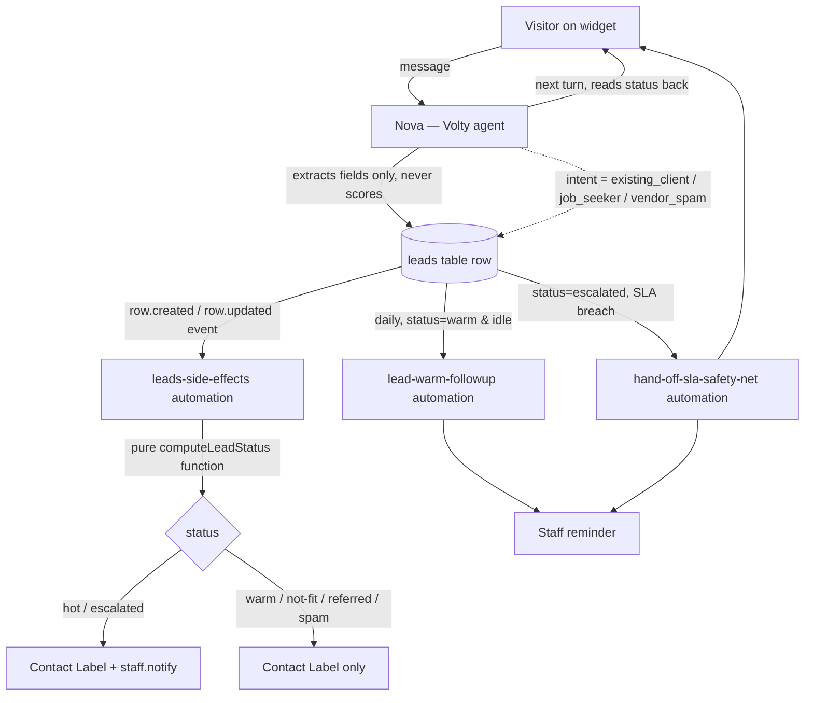

# Nova — Lead Qualification Agent for Northwind Creative

Nova is an AI lead-qualification agent built on [Volty](https://volty.voltade.com), for **Northwind Creative**, a fictional Singapore performance-marketing agency (Meta Ads, Google Ads, Social Media Management, Website Design). This repo is both the working agent's source and the harness around it: the knowledge, tools, rules, human handover, and tests that make the agent dependable — not just a chatbot.

- **Landing page / try it:** _placeholder — link once deployed page is finalized_
- **Case study:** _placeholder — link once written_

## Key design decision: the LLM extracts, code decides

Nova never scores a lead herself. She extracts raw fields from conversation (`monthly_budget_sgd`, `timeline_days`, `service_needed`, `decision_maker`) and writes them to a `leads` table row — nothing more. A **pure, unit-tested TypeScript function** (duplicated into the automations that react to that row — see [Architecture](#architecture)) computes `status` (`hot`/`warm`/`not-fit`/`escalated`) deterministically from `params` and the matched service's floor. The tradeoff this costs: the computed status isn't available within the same turn Nova finishes extracting the last field — she acknowledges warmly that turn, and delivers the actual verdict (booking link / email ask / decline / handover) once she reads `status` back on the next turn. Reliability (one source of truth, fully testable, no LLM arithmetic) was chosen over immediacy. Full reasoning in [`docs/PLAN.md`](docs/PLAN.md) §12/A1.

## Architecture



Everything a human sees happens through two channels: the **Contact Label** on the conversation (hot/warm/not-fit/escalated/referred/spam) and a **staff notification** for anything that needs a person (hot leads, escalations, SLA breaches, warm-lead follow-up reminders). Nova's only side-effect tool calls, ever, are `rows.insert`/`rows.update` on `leads` — she is explicitly instructed never to call a native hand-off tool herself, keeping exactly one path to a human.

## Folder structure

```
instructions/org.md          Nova's full prompt — role, field extraction, guardrails, handover
inboxes/                     Per-inbox config (website widget inbox + sandbox)
params.ts                    Admin-tunable values (hotBudget, escalateBudget, bookingUrl, ...)
automations/
  leads-side-effects-*.ts    Deterministic scoring + Contact Label + staff.notify (row.created/updated)
  lead-warm-followup.ts      Daily reminder for idle warm leads (staff-notify fallback — see docs/BUGS.md #6)
  hand-off-sla-safety-net.ts Holding message + re-notify on an escalated conversation's SLA breach
lib/score-lead.ts            The pure scoring function, unit-tested in isolation
tests/
  score-lead.test.ts         Unit tests for the pure function (bun test)
  scenarios.ts / run-scenarios.ts   End-state integration tests against the live agent
  results.md                 Latest test run's pass/fail + cost + credits
landing-page/                Static demo site with the Volty chat widget embedded
scripts/snapshot-live.ts     Reads live workspace state back into this repo (see below)
docs/
  PLAN.md                    The full build plan, decisions, and findings log
  BUGS.md                    Every bug found during live testing, how it was caught, the fix
  VOLTY_BUG_REPORT.md         A platform bug filed with the Volty team (see below)
```

## Running the tests

```bash
bun install
bun test tests/score-lead.test.ts      # pure scoring function, no AI, no network
bun run tests/run-scenarios.ts          # end-state scenarios against the live agent (costs Volty AI credits)
```

The integration suite grades from the **final state** of the `leads` row and Contact Labels, not reply wording — see `docs/PLAN.md` for the full methodology (simulated personas, negative tests, pass³ reporting, LLM judges).

## A known platform bug, and how this repo works around it

`volty push`/`volty pull` are currently blocked workspace-wide by an unresolved Volty platform bug — full report in [`docs/VOLTY_BUG_REPORT.md`](docs/VOLTY_BUG_REPORT.md), tracked in [`docs/BUGS.md`](docs/BUGS.md) (#11). Every change since is deployed through individual live ops (`instructions update`, `automations update-source`, `params set-value`) instead of `push`. To keep this repo matching the live workspace without a working `pull`, `scripts/snapshot-live.ts` reads live state back via those same single-target read ops into `snapshot/` — run before every commit.
